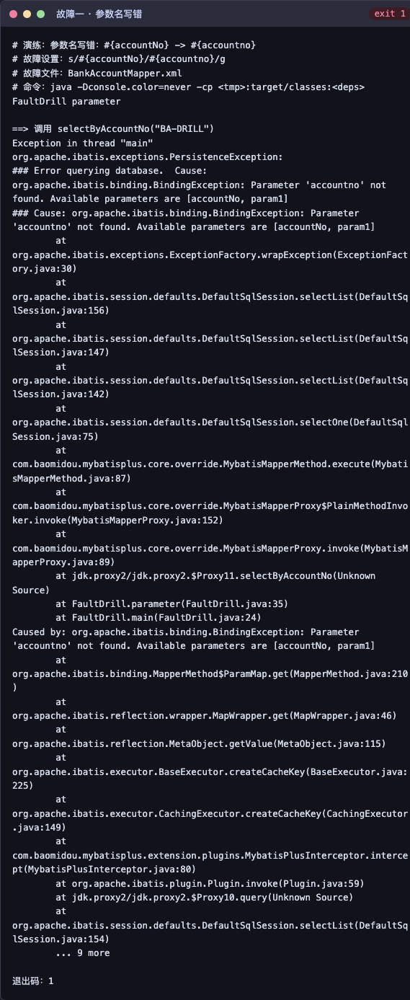
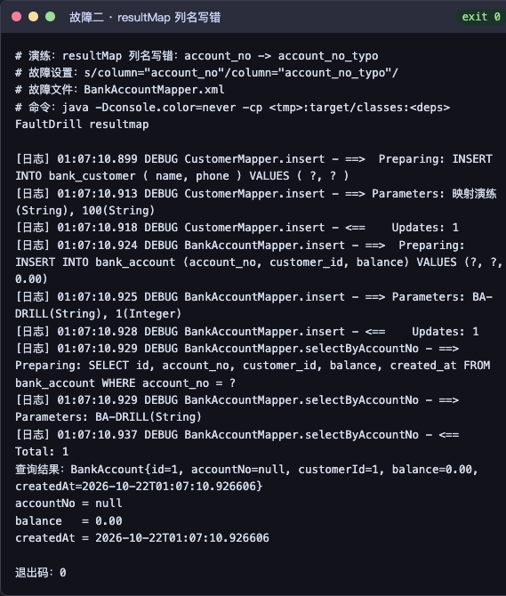
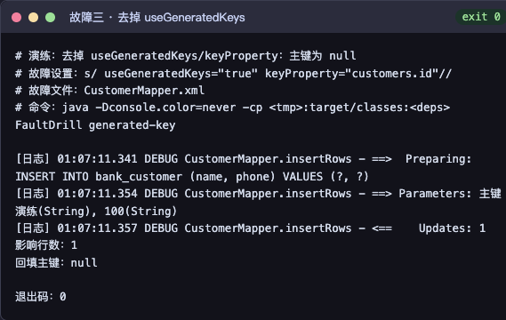

# 实验任务 5.1：故障排查演练

## 1. 目的与范围

按实验要求故意制造三类持久层故障，观察 Log4j + MyBatis 日志现象，记录排查过程与结论：

| 编号 | 故障 | 预期现象 |
|---|---|---|
| 1 | 映射文件占位符参数名写错 | `BindingException: Parameter 'xxx' not found` |
| 2 | `resultMap` 的 `column` 写错 | 查询成功但对应属性为 `null` |
| 3 | 去掉 `<insert>` 的 `useGeneratedKeys` | 插入成功但回填主键为 `null` |

演练**不修改 `src` 下的任何源码/映射**：使用临时数据库 `bank_fault_drill`，并把故障版 Mapper XML 放在临时目录，通过 classpath 优先级覆盖。

## 2. 复现方法

```sh
# 1. 确保已编译并生成依赖类路径
./apache-maven-3.9.6/bin/mvn -o -Dmaven.repo.local=./maven_localdb \
  -DskipTests compile dependency:build-classpath \
  -Dmdep.outputFile=target/runtime-classpath.txt

# 2. 执行三组演练（自动建库、注入故障、运行、写日志、删库）
bash docs/fault-drill/drill/run-drills.sh
```

产物：

- 演练程序：`drill/FaultDrill.java`
- 执行脚本：`drill/run-drills.sh`
- 实际日志：`logs/01-parameter-binding.log`、`logs/02-resultmap-column.log`、`logs/03-generated-key.log`
- 故障截图：`screenshots/01-parameter-binding.png`、`screenshots/02-resultmap-column.png`、`screenshots/03-generated-key.png`
- 截图来源：`fault-drill.html` 由上述**实际日志**渲染后截图生成，未伪造输出。

## 3. 故障一：参数名写错

**注入方式**：`BankAccountMapper.xml` 中把 `#{accountNo}` 改为 `#{accountno}`（大小写不一致）。

**实际日志（节选）**：

```text
==> 调用 selectByAccountNo("BA-DRILL")
Exception in thread "main" org.apache.ibatis.exceptions.PersistenceException:
### Error querying database.  Cause: org.apache.ibatis.binding.BindingException:
Parameter 'accountno' not found. Available parameters are [accountNo, param1]
```

**现象**：SQL 尚未发送到数据库就抛异常，日志直接给出可用参数列表 `[accountNo, param1]`。

**原因**：接口使用 `@Param("accountNo")`，MyBatis 用参数名构建 `ParamMap`；XML 中的 `#{accountno}` 找不到同名键。

**排查与修复**：
1. 看异常第二行 `Available parameters are [...]`，确认实际可用参数名；
2. 将 `#{accountno}` 改回 `#{accountNo}`；
3. 若接口未写 `@Param`，多参数场景需补 `@Param` 显式命名。

**结论**：参数名必须与 `@Param`/属性名完全一致，MyBatis 参数绑定大小写敏感。



## 4. 故障二：resultMap 列名写错

**注入方式**：`accountMap` 中把 `column="account_no"` 改为 `column="account_no_typo"`。

**实际日志（节选）**：

```text
[日志] DEBUG BankAccountMapper.selectByAccountNo - ==>  Preparing:
SELECT id, account_no, customer_id, balance, created_at FROM bank_account WHERE account_no = ?
[日志] DEBUG BankAccountMapper.selectByAccountNo - <==      Total: 1
查询结果：BankAccount{id=1, accountNo=null, customerId=1, balance=0.00, createdAt=2026-10-22T01:07:10.926606}
accountNo = null
```

**现象**：SQL 正常执行，`Total: 1`，但 `accountNo` 为 `null`；同一行的 `customerId`、`balance`、`createdAt` 正常。

**原因**：`resultMap` 声明的列名 `account_no_typo` 在结果集中不存在，MyBatis 无法取值，默认静默设为 `null`（未开启未知列告警）。

**排查与修复**：
1. 日志确认 SQL 与行数正常，问题在映射而非 SQL；
2. 逐字段对比 `resultMap` 的 `column` 与 SELECT 列清单（本项目用 `<include refid="allColumns"/>`，可直接对照 `<sql>` 内容）；
3. 把列名改回 `account_no`，或改用 `resultType` + `mapUnderscoreToCamelCase`。

**结论**：映射错误不会抛异常，只能通过“有行数但字段为 null”发现；`resultMap` 的 `column` 必须是查询结果中的真实列名。



## 5. 故障三：去掉 useGeneratedKeys

**注入方式**：`CustomerMapper.xml` 的 `insertRows` 删除 `useGeneratedKeys="true" keyProperty="customers.id"`。

**实际日志（节选）**：

```text
[日志] DEBUG CustomerMapper.insertRows - <==    Updates: 1
影响行数：1
回填主键：null
```

**现象**：插入成功（影响 1 行），但实体主键仍为 `null`。

**原因**：自增主键回填依赖 `<insert>` 上的 `useGeneratedKeys="true"` 与 `keyProperty`；缺失后 JDBC 不会把生成键写回参数对象。批量插入的 `keyProperty` 需指向集合元素属性（本项目为 `customers.id`）。

**排查与修复**：
1. 用 `Updates: 1` 确认写入成功、问题在回填；
2. 检查 `<insert>` 的 `useGeneratedKeys/keyProperty` 是否缺失或路径写错；
3. 补齐属性后重新执行，主键应回填。

**结论**：`useGeneratedKeys` 只影响“主键回填”，不影响插入本身；主键为 null 时应优先检查该属性。



## 6. 总体结论

| 故障 | 是否抛异常 | 日志关键线索 | 修复点 |
|---|---|---|---|
| 参数名不一致 | 是 | `Available parameters are [...]` | XML 占位符与 `@Param` 对齐 |
| resultMap 列名错误 | 否 | `Total: 1` 但字段为 `null` | `column` 与查询列名对齐 |
| 去掉 useGeneratedKeys | 否 | `Updates: 1`、主键 `null` | 补 `useGeneratedKeys` + `keyProperty` |

三类问题中，只有参数绑定会立即失败；映射与主键回填问题都是“静默失败”，必须结合日志中的 SQL、`Parameters`、`Total/Updates` 与对象状态一起判断。
